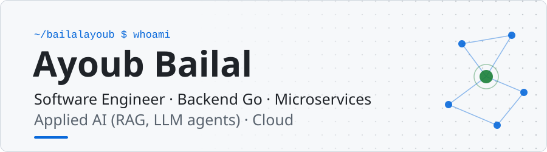
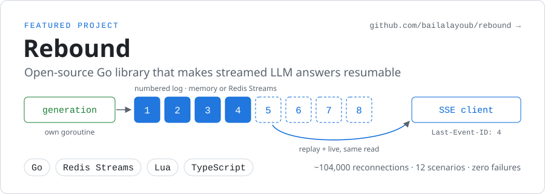

<picture>
  <source media="(prefers-color-scheme: dark)" srcset="https://github.com/bailalayoub/bailalayoub/raw/main/assets/banner-dark.svg">
  <source media="(prefers-color-scheme: light)" srcset="https://github.com/bailalayoub/bailalayoub/raw/main/assets/banner-light.svg">
  
</picture>

**Scalable architecture | Generative AI | DevOps | Fullstack React/TypeScript**

<a href="#about-me">About</a> ·
<a href="#featured-rebound">Rebound</a> ·
<a href="#projects">Projects</a> ·
<a href="#skills--tech-stack">Skills</a> ·
<a href="#experience">Experience</a> ·
<a href="#github-stats">Stats</a> ·
<a href="#education">Education</a> ·
<a href="#extracurricular--events">Events</a> ·
<a href="#contact-me">Contact</a>

---

## About Me

IT engineer from **ENSAO**, with **2+ years of experience** as a Software Engineer on an EdTech platform. I specialise in **Go** backend development in a **microservices** architecture (secure APIs, PostgreSQL, Redis, MinIO), in **generative AI** features (RAG, embeddings, LLM agents, OpenAI integration), and in cloud deployment with **Docker** and **CI/CD**.

I care about systems that stay correct when the network, the model or the server does not. I work across the stack, from infrastructure and databases to **React/TypeScript** interfaces.

 

---

## Featured: Rebound

<a href="https://github.com/bailalayoub/rebound">
  <picture>
    <source media="(prefers-color-scheme: dark)" srcset="https://github.com/bailalayoub/bailalayoub/raw/main/assets/rebound-dark.svg">
    <source media="(prefers-color-scheme: light)" srcset="https://github.com/bailalayoub/bailalayoub/raw/main/assets/rebound-light.svg">
    
  </picture>
</a>

**[Rebound](https://github.com/bailalayoub/rebound)** is an open-source Go library that makes streamed LLM answers resumable. When a connection drops, the client picks up exactly where it left off, on any server: no gap, no duplicate, no answer generated twice.

- The generation runs in its own goroutine, detached from the HTTP request, and writes to a numbered log (in memory, or Redis Streams with atomic Lua scripts).
- Every SSE client reads that log from its `Last-Event-ID`. Replay and live are the same read.
- `net/http` and Gin adapters, a dependency-free TypeScript client, and a conformance tester that drops connections at random: about 104,000 reconnections across 12 scenarios, zero failures.

📖 Read the story: [Your LLM answer shouldn't die with the HTTP connection](https://medium.com/@bailalayoub/your-llm-answer-shouldnt-die-with-the-http-connection-d97be23a6a74)

---

## Projects

<table>
<tr>
<td width="50%" valign="top">
<b><a href="https://github.com/bailalayoub/rebound">Rebound</a></b> 
Open-source library for resumable LLM streams over SSE, multi-instance with Redis  
<code>Go</code> <code>Redis&nbsp;Streams</code> <code>Lua</code> <code>TypeScript</code>
</td>
<td width="50%" valign="top">
<b>Supplier offer ingestion platform</b> (freelance) 
Turns unstructured supplier offers (email, WhatsApp, PDF, Excel, images) into validated product data: event-driven pipeline, LLM extraction with deterministic business rules, dead-letter queue, token budget, human review  
<code>Python</code> <code>FastAPI</code> <code>PostgreSQL</code> <code>Redis</code> <code>Claude&nbsp;API</code> <code>AWS&nbsp;S3</code> <code>React</code>
</td>
</tr>
<tr>
<td width="50%" valign="top">
<b>Tilmid+</b> 
Adaptive AI tutor: RAG treated as a data pipeline (OCR, chunking, embeddings, Qdrant), LangGraph agents with tool calling, real-time SSE chat, 3D learning world  
<code>Go</code> <code>Python</code> <code>LangGraph</code> <code>OpenAI</code> <code>Qdrant</code> <code>React</code> <code>Three.js</code>
</td>
<td width="50%" valign="top">
<b>Tilmicode</b> 
E-learning platform that teaches programming to children: Blockly, Phaser mini-games, Python editor, FR/EN/AR with Arabic RTL, online payment  
<code>Go</code> <code>Gin</code> <code>Python</code> <code>PostgreSQL</code> <code>MinIO</code> <code>React</code>
</td>
</tr>
<tr>
<td width="50%" valign="top">
<b>TilmiSchool</b> 
Multi-tenant school management SaaS with per-tenant isolation and SSO shared across three applications  
<code>Go</code> <code>Gin</code> <code>PostgreSQL</code> <code>React</code> <code>Docker</code>
</td>
<td width="50%" valign="top">
<b>Cloud data platform</b> 
Three-layer data platform on Google Cloud with encryption before storage  
<code>Pub/Sub</code> <code>Dataflow</code> <code>BigQuery</code> <code>Cloud&nbsp;Run</code>
</td>
</tr>
<tr>
<td width="50%" valign="top">
<b>GENANO, anonymisation engine</b> 
Configuration-driven encryption, hashing and anonymisation of JSON, CSV, XML, TXT, HTML, DOCX and XLSX, plus synthetic data generation  
<code>Python</code> <code>FastAPI</code> <code>Cloud&nbsp;Run</code> <code>Cloud&nbsp;Storage</code>
</td>
<td width="50%" valign="top">
<b><a href="https://www.bailalayoub.com/">3D portfolio</a></b> 
Personal portfolio as a navigable 3D experience  
<code>Next.js</code> <code>TypeScript</code> <code>React&nbsp;Three&nbsp;Fiber</code> <code>GSAP</code>
</td>
</tr>
</table>

<b>Academic projects</b> (4)

 

<table>
<tr>
<td width="50%" valign="top">
<b>Vehicle detection</b> (academic) 
Real-time vehicle detection and classification for urban traffic analysis  
<code>Computer&nbsp;vision</code> <code>Python</code>
</td>
<td width="50%" valign="top">
<b>Emotion detection</b> (academic) 
Real-time emotion recognition from a webcam with a CNN trained on FER-2013  
<code>Python</code> <code>CNN</code>
</td>
</tr>
<tr>
<td width="50%" valign="top">
<b>Traffic sign recognition</b> (academic) 
Real-time traffic sign detection and classification  
<code>Computer&nbsp;vision</code> <code>Python</code>
</td>
<td width="50%" valign="top">
<b>Sales dashboard</b> (academic) 
Executive sales report with fbprophet forecasting  
<code>Power BI</code> <code>Python</code>
</td>
</tr>
</table>

---

## Skills & Tech Stack

<table>
<tr>
<td><b>Languages</b></td>
<td>

</td>
</tr>
<tr>
<td><b>Frameworks & Libraries</b></td>
<td>

</td>
</tr>
<tr>
<td><b>AI & Generative</b></td>
<td>

</td>
</tr>
<tr>
<td><b>Databases & Storage</b></td>
<td>

</td>
</tr>
<tr>
<td><b>Cloud & DevOps</b></td>
<td>

</td>
</tr>
<tr>
<td><b>Architecture & Patterns</b></td>
<td>

</td>
</tr>
<tr>
<td><b>Data Visualization</b></td>
<td>

</td>
</tr>
</table>

---

## Experience

### 🚀 Software Engineer · Tilmicode, Sidra platform
September 2024 → present

- Design of a **complete microservices ecosystem** (Go/Python) for education and AI
- Production **AI/RAG pipeline**: OCR, chunking, OpenAI embeddings, Qdrant vector search
- **Real-time AI chat** with SSE streaming, quota management and payment integration
- Subscription system with **scheduled activation** and inter-service orchestration
- Advanced **React/TypeScript** frontends: Blockly, Phaser and CodeMirror editors
- Large-scale storage (PostgreSQL, MinIO, Qdrant), migrations, asynchronous pipelines
- Full industrialisation: Docker, CI/CD, **Prometheus**, structured logging with Zap
- Inter-service security: JWT, internal tokens, CORS

### 💼 Freelance · Supplier offer ingestion platform
Client in the Netherlands

- Event-driven pipeline: webhook, queue, workers, LLM extraction, deterministic business rules, human review, export
- Idempotency, administrable dead-letter queue, controlled retries, fail-closed daily token budget

### 🎓 Final-year internship · Vision Business Consulting
February → July 2024

- Built **GENANO**: anonymisation, encryption and hashing across formats (JSON, CSV, TXT, XML)
- Deployment on **Google Cloud Platform** (Cloud Run, Dataflow, BigQuery, Cloud Functions)
- Pipelines for large structured, semi-structured and unstructured data transfers
- GitHub repositories, DevOps practices, monitoring of scheduled modules

---

## GitHub Stats

<picture>
  <source media="(prefers-color-scheme: dark)" srcset="https://github.com/bailalayoub/bailalayoub/raw/main/assets/stats-dark.svg">
  <source media="(prefers-color-scheme: light)" srcset="https://github.com/bailalayoub/bailalayoub/raw/main/assets/stats-light.svg">
  
</picture>
<picture>
  <source media="(prefers-color-scheme: dark)" srcset="https://github.com/bailalayoub/bailalayoub/raw/main/assets/top-langs-dark.svg">
  <source media="(prefers-color-scheme: light)" srcset="https://github.com/bailalayoub/bailalayoub/raw/main/assets/top-langs-light.svg">
  
</picture>

---

## Education

🎓 **École Nationale des Sciences Appliquées d'Oujda (ENSAO)** 
*Engineering degree in Information Technology and Communication Networks* · `2019 → 2024`

---

## Extracurricular & Events

| | Event | Role |
|---|---|---|
| 🎙️ | **GITEX Africa 2026** | Exhibitor with Tilmicode · Investor and startup meetings |
| 🤖 | **Assises Nationales de l'IA 2025** | Exhibitor with Tilmicode · UM6P · Ministry of Digital Transition |
| 🌍 | **GITEX Africa 2024** | Participant with Vision Business Consulting |
| 📰 | **MAGENSAO** 2021 – 2023 | Digital Team Leader · First ENSAO magazine |
| 🏛️ | **ITIRC Club** 2021 – 2023 | President · IT & Networks club, ENSAO |
| 🎨 | **EUGO** 2022 | Graphic Designer · National event, 500+ students |
| 🖼️ | **JPO Open Day** 2023 | Designer · 11th edition, ENSAO |

---

## Contact Me

<table>
<tr><td><b>Email</b></td><td><a href="mailto:bailalayoub4905@gmail.com">bailalayoub4905@gmail.com</a></td></tr>
<tr><td><b>Portfolio</b></td><td><a href="https://www.bailalayoub.com/">https://www.bailalayoub.com/</a></td></tr>
<tr><td><b>LinkedIn</b></td><td><a href="https://www.linkedin.com/in/ayoubbailal">https://www.linkedin.com/in/ayoubbailal</a></td></tr>
<tr><td><b>Medium</b></td><td><a href="https://medium.com/@bailalayoub">https://medium.com/@bailalayoub</a></td></tr>
<tr><td><b>Phone</b></td><td>+212 708342354</td></tr>
<tr><td><b>Location</b></td><td>Rabat, Morocco</td></tr>
</table>
